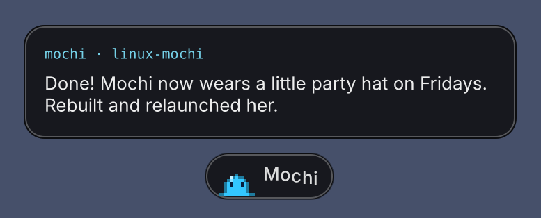
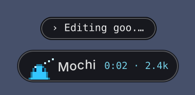
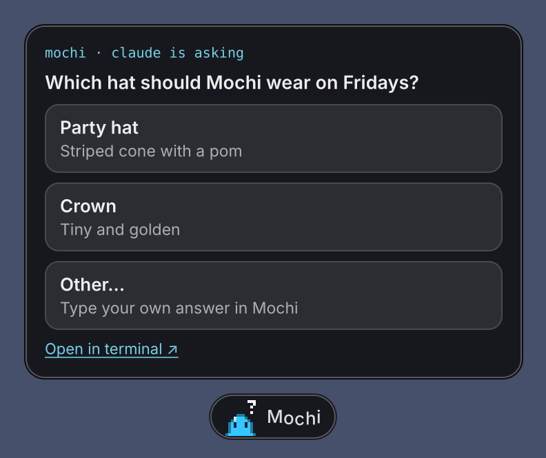
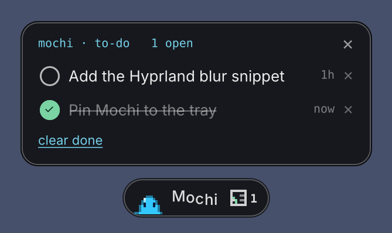
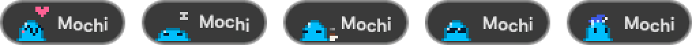

<p align="center"></p>

<h1 align="center">Mochi for Linux</h1>
<p align="center"><b>A tiny pixel goo who lives at the bottom of your screen and talks to Claude Code for you.</b><br>
A Wayland port of <a href="https://github.com/jessawolfe-ux/mochi">Mochi</a> by <a href="https://jessa.art">Jessa Wolfe</a>, made for Arch / CachyOS + Hyprland.</p>

---

Mochi floats over everything on your desktop. Click her, type, and your message goes straight to **Claude Code** running in your terminal. When Claude answers, she pops the reply up in a little bubble. She shows what Claude is doing while it works, answers its multiple-choice questions for you, and keeps a tiny to-do list of things Claude needs *you* to do.

She also breathes, blinks, follows your cursor, hops when you send something, gets sleepy when it's quiet, and dresses for the time of day.

<p align="center"></p>

## What she does

- 💬 **Message Claude from anywhere.** No need to find the terminal window.
- 🫧 **Reply bubbles.** A short summary of Claude's answer pops up above her; long replies come in pages (arrows, or ← → while she's open).
- 👀 **Live progress.** A one-line "doing…" status and a little time/token meter while Claude works.
- ❓ **Answers questions.** When Claude asks you to pick an option, pick it right from Mochi.
- ✅ **To-do list.** Claude can add things you need to do yourself; Mochi reminds you.
- 🎨 **Any color you like.** Pick one when you install, or right-click her.

| | |
|---|---|
|  | **While Claude works:** what it's doing right now, plus a timer and token count. |
|  | **Questions:** click an option and she answers in your terminal. |
|  | **To-dos:** things Claude needs *you* to do. Tell her `todo: buy matcha`, `what's on my list`, `done 1`. |

**Moods and outfits.** She gets petted, falls asleep when it's quiet, has coffee in the morning, wears sunglasses on Friday afternoons and a nightcap late at night:

<p align="center"></p>

## What you need

- **Arch Linux or an Arch-based distro** (CachyOS, EndeavourOS, …). The installer uses pacman.
- **A Wayland compositor with layer-shell**:

  | Compositor | Floats over windows | Eyes follow cursor | Typing into a plain terminal window | Blur |
  |---|---|---|---|---|
  | **Hyprland** | ✅ | ✅ everywhere | ✅ | ✅ (snippet below) |
  | Sway | ✅ | near Mochi | ✅ | – |
  | KDE Plasma, niri, river, … | ✅ | near Mochi | use tmux / kitty / WezTerm | KDE: ✅ |
  | GNOME | ❌ (no layer-shell): ordinary window | near Mochi | use tmux / kitty / WezTerm | – |

- **[Claude Code](https://docs.claude.com/en/docs/claude-code)** installed.

## Install

```bash
git clone https://github.com/chiangs/linux-mochi.git
cd linux-mochi
./install.sh
```

The installer will:

1. Install what she needs, after asking: `python-gobject python-cairo gtk4 gtk4-layer-shell wl-clipboard wtype tmux`
2. Ask **what color you want Mochi to be** 🎨
3. Ask **how she should reach Claude** (tmux, or straight into your terminal window) and which terminal to open when none is running
4. Put her in `~/.local` (run her with `mochi`), with a desktop entry and icon
5. Connect her to Claude Code by adding a few hooks to `~/.claude/settings.json` (your old settings are backed up first)

### Hyprland

To blur behind her glass and start her with Hyprland, paste one of these into your config:

- **Hyprland 0.55+** (`hyprland.lua`): [`packaging/hyprland.lua`](packaging/hyprland.lua)
- **Hyprland 0.54 and older** (`hyprland.conf`): [`packaging/hyprland.conf`](packaging/hyprland.conf)

With blur on, set `"glass_alpha": 0.7` in `~/.local/share/mochi/config.json` so it shows through.

"Open at Login" in her menu writes an XDG autostart entry. Hyprland only runs those if you use something like **uwsm** or **dex**, so the snippet's autostart line is the sure way.

## How she reaches Claude

Mochi finds every running `claude` and talks to the one whose terminal you used last. How she gets text into it depends on where it runs:

| Claude is running… | How Mochi sends | Notes |
|---|---|---|
| **inside tmux** (recommended) | `tmux paste-buffer` + Enter | Your focus never moves, your clipboard is never touched, works even if the window is hidden. Start Claude with `tmux new -A -s claude claude`. |
| in **kitty** | `kitten @ send-text` | Needs `allow_remote_control yes` and `listen_on unix:@kitty` in `kitty.conf`. |
| in **WezTerm** | `wezterm cli send-text` | Works out of the box. |
| in **Alacritty**, foot, Ghostty, … | Focuses the window (Hyprland/Sway), pastes with `wtype`, presses Return, then puts you back where you were and restores your clipboard | Like the Mac version. Don't type during that half-second. |

If no Claude is running, she opens your terminal with `claude --continue` (inside tmux, if you chose that) in the folder of your most recent Claude session, and sends your message once it's up. If Claude first asks whether to trust that folder, she waits for you to answer it in the terminal and then sends. Set `wake_dir` in `config.json` to always start somewhere specific.

## Using her

| | |
|---|---|
| **Click** | Open her message bar, type, press Return. Esc folds her up. |
| **Drag** | Move her anywhere along the bottom of the screen |
| **Right-click** | Her menu: open at login, color, quit |
| **Hover** | She'll wiggle. Keep hovering and she gets petted 💗 |
| **Tray icon** | Find Mochi, message her, to-do list, show/hide (Waybar's `tray` module, KDE, …) |

## Ask Claude to change her

The installer teaches Claude Code how to work on Mochi (it adds a small `mochi` skill to `~/.claude/skills`). So you can just ask Claude, in any project:

> "Make Mochi wear a little party hat on Fridays"
> "Make Mochi purple"
> "Have Mochi do a backflip when Claude finishes"

Claude edits her code, reinstalls her and restarts her.

## Make her yours

Mochi is a small Python package, so she's easy to remix:

| File | What's in it |
|---|---|
| [`mochi/goo.py`](mochi/goo.py) | The goo: shape, eyes, moods, outfits (pixel cells, y-up, like the original) |
| [`mochi/parts.py`](mochi/parts.py) | The paper plane, the bobbing name, badges |
| [`mochi/bar.py`](mochi/bar.py) | The pill, reply bubble, questions, to-do list, menus, sending |
| [`mochi/terminals.py`](mochi/terminals.py) | Finding Claude sessions and typing into them |
| [`mochi/compositor.py`](mochi/compositor.py) | Hyprland / Sway specifics |
| [`mochi/config.py`](mochi/config.py) | Every setting and its default (`~/.local/share/mochi/config.json`) |
| [`hooks/notify.py`](hooks/notify.py) | The Claude Code hook that tells Mochi what Claude is doing (writes JSON files she watches) |

Change anything, then `./install.sh --rebuild`. To try looks without waiting: `PB_HOUR=8 mochi`, `PB_WEEKDAY=6 PB_HOUR=14 mochi`, `PB_MOOD=sleepy mochi` (also `pet`, `proud`, `worried`), `PB_DEMO=send mochi`.

Add to-dos from the command line (or let Claude do it):

```bash
python3 ~/.local/share/mochi/hooks/todo.py add "Upload the new images"
```

See [CONTRIBUTING.md](CONTRIBUTING.md) for how the code fits together, tests, and adding support for another terminal or compositor.

## Updates

```bash
cd linux-mochi && ./install.sh --update
```

## Troubleshooting

- **Messages don't arrive:** look in `~/.local/state/mochi/mochi.log`. She flashes a short reason on the pill too (`install wtype`, `no window`, `use tmux`, …).
- **She's an ordinary window instead of floating:** your compositor lacks layer-shell (GNOME), or `gtk4-layer-shell` isn't installed.
- **Run her in a terminal** (`mochi`) to see errors.

## Uninstall

```bash
./uninstall.sh
```

This removes her, her data, her Claude Code hooks and the Mochi skill.

---

The original macOS app is kept in [`macos/`](macos/) for reference.

<p align="center">Mochi made with 🫧 by <a href="https://jessa.art">Jessa Wolfe</a>. Linux port by <a href="https://github.com/chiangs">chiangs</a>.</p>
