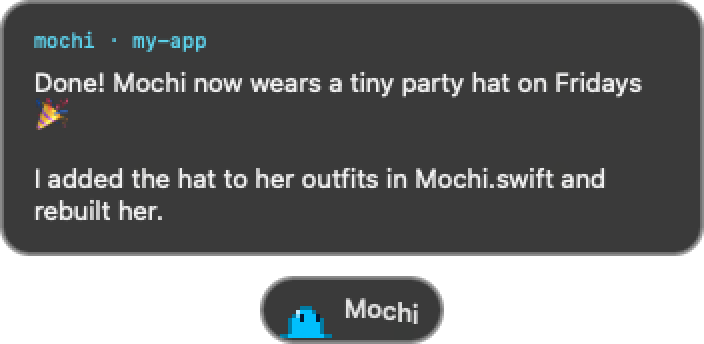
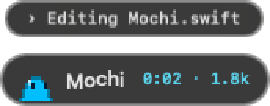
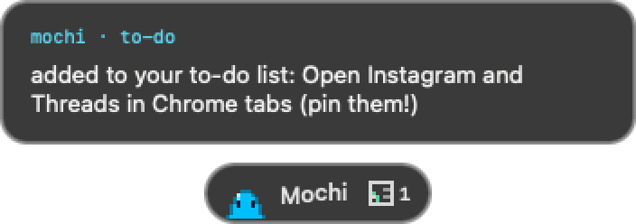

<p align="center"></p>

<h1 align="center">Mochi</h1>
<p align="center"><b>A tiny pixel goo who lives at the bottom of your screen and talks to Claude Code for you.</b></p>

---

Mochi floats over everything on your Mac. Click her, type, and your message goes straight to **Claude Code** running in Terminal. When Claude answers, she pops the reply up in a little bubble. She shows what Claude is doing while it works, answers its multiple-choice questions for you, and keeps a tiny to-do list of things Claude needs *you* to do.

She also breathes, blinks, follows your cursor, hops when you send something, gets sleepy when it's quiet, and dresses for the time of day.

<p align="center"></p>

## What she does

- 💬 **Message Claude from anywhere.** No need to find the Terminal window.
- 🫧 **Reply bubbles.** A short summary of Claude's answer pops up above her; long replies page with the arrow keys.
- 👀 **Live progress.** A one-line "doing…" status and a little time/token meter while Claude works.
- ❓ **Answers questions.** When Claude asks you to pick an option, pick it right from Mochi.
- ✅ **To-do list.** Claude can add things you need to do yourself; Mochi reminds you.
- 🎨 **Any color you like.** Pick one when you install, or right-click her → *Change Mochi's Color…*
- 🔔 **Social notifications (optional).** Turn it on in the installer and she shows little badges for new Instagram, Threads, LinkedIn or X notifications. She reads the unread count from tabs you already have open in Chrome, like "(3) Instagram": no logins, nothing leaves your Mac. Click a badge to jump to that tab.
  > **Keep those sites open in Chrome tabs.** Mochi can only see sites that have a tab open, so pin them (right-click the tab → *Pin*) and they'll always be there. The installer adds this to Mochi's to-do list as a reminder.

### A few of her tricks

| | |
|---|---|
|  | **While Claude works:** what it's doing right now, plus a timer and token count. |
|  | **Social badges:** new notifications from tabs open in Chrome. Click one to jump there. |
|  | **To-dos:** things Claude needs *you* to do. |

**Moods and outfits.** She gets petted, falls asleep when it's quiet, has coffee in the morning, wears sunglasses on Friday afternoons and a nightcap late at night:

<p align="center"></p>

**Any color you like:**

<p align="center"></p>

## Install

You need a Mac (macOS 13 or newer) and [Claude Code](https://docs.claude.com/en/docs/claude-code) installed.

Open **Terminal** and run:

```bash
git clone https://github.com/jessawolfe-ux/mochi.git
cd mochi
./install.sh
```

No git? Click the green **Code** button above → **Download ZIP**, unzip it, then in Terminal `cd` into the folder and run `./install.sh`.

The installer will:

1. Ask **what color you want Mochi to be** 🎨
2. Ask if you want **social notifications**, and for which sites
3. Build her (takes about 30 seconds) and put her in `~/Applications`
4. Connect her to Claude Code by adding a few hooks to `~/.claude/settings.json` (your old settings are backed up first)

### Permissions

The first time Mochi sends a message, macOS will ask to let her control **Terminal**: say OK. If you turned on social notifications, it also asks about **Google Chrome**. She also needs **Accessibility** to type into Terminal: *System Settings → Privacy & Security → Accessibility → turn on Mochi*.

## Using her

| | |
|---|---|
| **Click** | Open her message bar, type, press Return |
| **Drag** | Move her anywhere along the bottom of the screen |
| **Right-click** | Her menu: change color, open at login, quit |
| **Hover** | She'll wiggle. Keep hovering and she gets petted 💗 |

If no Terminal tab is running Claude, she opens one with `claude --continue` and sends your message there.

## Ask Claude to change her

The installer teaches Claude Code how to work on Mochi (it adds a small `mochi` skill to `~/.claude/skills`). So you can just ask Claude, in any project:

> "Make Mochi wear a little party hat on Fridays"
> "Make Mochi purple"
> "Have Mochi do a backflip when Claude finishes"

Claude edits her code, rebuilds her and relaunches her. Her code is signed with a certificate the installer makes just for your Mac (kept in your login keychain), so macOS remembers her permissions every time she's rebuilt.

## Updates

```bash
cd mochi && ./install.sh --update
```

This gets the newest Mochi from GitHub and rebuilds her, keeping your color and settings. (Or just ask Claude: "update Mochi".)

## Make her yours

Mochi is one Swift file, `Sources/Mochi.swift`, so she's easy to remix: her outfits, moods, colors and animations are all in there. Change anything, then run `./install.sh --rebuild` to rebuild and relaunch her (or ask Claude to do it).

The hook script, `hooks/notify.py`, is what tells Mochi what Claude is doing. It writes small JSON files into `~/Library/Application Support/Mochi/`, which she watches.

Add to-dos from the command line (or let Claude do it):

```bash
python3 ~/Library/Application\ Support/Mochi/hooks/todo.py add "Upload the new images"
```

## Uninstall

```bash
./uninstall.sh
```

This removes the app, her data, her Claude Code hooks and the Mochi skill.

---

<p align="center">Made with 🫧 by <a href="https://jessa.art">Jessa Wolfe</a>.</p>
